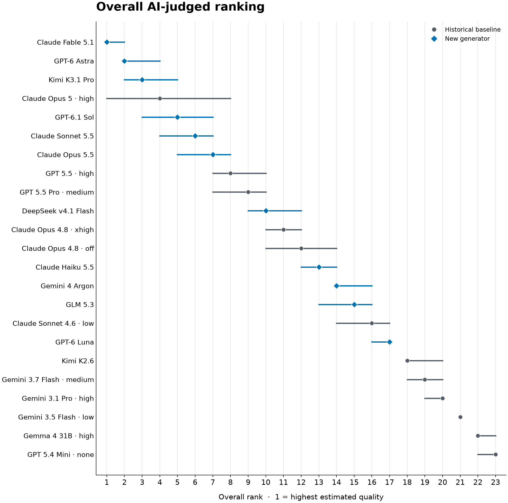
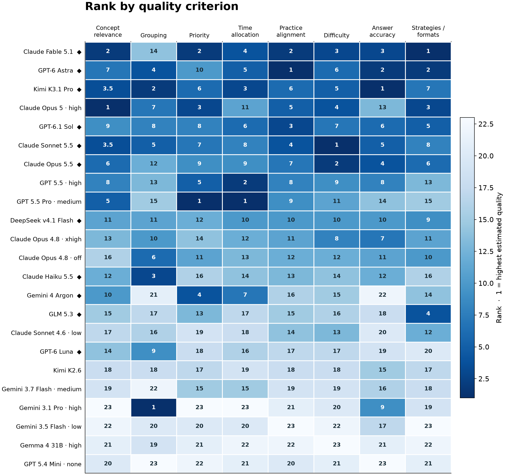

# StudentBench lesson-plan leaderboard

The November 3 StudentBench leaderboard compares 23 lesson-plan generator
systems on 83 frozen GRE Quant student contexts. An AI judge evaluated 7,476
pairwise comparisons and 59,808 rubric answers across eight quality criteria,
with no missing or abstained answers. Eleven generated systems each produced
83 plans; the 12 historical systems have different available student counts.
The update adds six systems and 498 plans to the November 2 release.

## AI-judged leaderboard

Rank 1 is the highest estimated quality. The Bradley–Terry (BT) score summarizes
pairwise preferences while accounting for opponents. Asterisks mark the 11 generated systems; other rows are historical baselines.

| Rank | Generator system | 95% rank range | BT score | Comparisons | Students |
| ---: | --- | ---: | ---: | ---: | ---: |
| 1 | Claude Fable 5.1 * | 1–2 | 0.999 | 1068 | 83 |
| 2 | GPT-6 Astra * | 2–4 | 0.911 | 1068 | 83 |
| 3 | Kimi K3.1 Pro * | 2–5 | 0.901 | 1068 | 83 |
| 4 | Claude Opus 5 · high | 1–8 | 0.851 | 168 | 13 |
| 5 | GPT-6.1 Sol * | 3–7 | 0.838 | 1068 | 83 |
| 6 | Claude Sonnet 5.5 * | 4–7 | 0.803 | 1068 | 83 |
| 7 | Claude Opus 5.5 * | 5–8 | 0.741 | 1068 | 83 |
| 8 | GPT 5.5 · high | 7–10 | 0.596 | 256 | 20 |
| 9 | GPT 5.5 Pro · medium | 7–10 | 0.593 | 237 | 17 |
| 10 | DeepSeek v4.1 Flash * | 9–12 | 0.437 | 1068 | 83 |
| 11 | Claude Opus 4.8 · xhigh | 10–12 | 0.307 | 245 | 18 |
| 12 | Claude Opus 4.8 · off | 10–14 | 0.251 | 159 | 12 |
| 13 | Claude Haiku 5.5 * | 12–14 | 0.111 | 1068 | 83 |
| 14 | Gemini 4 Argon * | 14–16 | -0.050 | 1068 | 83 |
| 15 | GLM 5.3 * | 13–16 | -0.066 | 1068 | 83 |
| 16 | Claude Sonnet 4.6 · low | 14–17 | -0.246 | 267 | 19 |
| 17 | GPT-6 Luna * | 16–17 | -0.342 | 1068 | 83 |
| 18 | Kimi K2.6 | 18–20 | -0.694 | 251 | 18 |
| 19 | Gemini 3.7 Flash · medium | 18–20 | -0.790 | 140 | 11 |
| 20 | Gemini 3.1 Pro · high | 19–20 | -0.961 | 379 | 28 |
| 21 | Gemini 3.5 Flash · low | 21–21 | -1.484 | 377 | 28 |
| 22 | Gemma 4 31B · high | 22–23 | -1.780 | 380 | 28 |
| 23 | GPT 5.4 Mini · none | 22–23 | -1.929 | 345 | 26 |

The 95% rank ranges come from 500 student-context bootstrap resamples; all 500
fits were connected and converged. They describe uncertainty for the saved plans
and do not establish a unique winner. A system combines a model with its generation
settings. Historical plans may include answer-verifier edits; the new plans use
the released prompt and reconstructed context without that historical verifier.
The pipelines are not historically equivalent, so the table compares the recorded
systems rather than models in isolation. These are AI judgments, not human grades
or measurements of student learning.



*Points are overall ranks; lines are 95% student-bootstrap rank ranges. Diamonds
mark the 11 generated systems; circles mark historical baselines.*



*Each column is a separately fitted criterion ranking; rows follow overall rank.
Darker cells indicate higher estimated quality, and diamonds mark the generated systems.
The overall intervals above use 500 student resamples; this heatmap shows point
ranks only.*

Explore the [public report](reports/2026-11-03/leaderboard.html),
[CSV](reports/2026-11-03/leaderboard.csv), and
[aggregate JSON](reports/2026-11-03/leaderboard.json). The
[plotting helper](reports/2026-11-03/plot_leaderboard.py) reproduces both figures
from the aggregate JSON. The detailed original judge-validation report remains
local at `results/ranking-study-20260910/report.html`. The original
[November 2 leaderboard](reports/2026-11-02/leaderboard.html) remains available.
This update is pinned to benchmark SHA-256
`320be135c5cabfe1013d75d6c06baddc3dcd2e08ac523ffbf8e7a5391f4e870a` and source
commit `b874167ebbfd2d993ccb3149e711a02d502b8299`. See the
[release notes](experiments/public-release/README.md) and [roadmap](docs/roadmap.md).

## Quick start

A fresh checkout does **not** include the private 83-context benchmark. Obtain a
prepared `gre-quant-v1` bundle from the data owner and place it at
`data/gre-quant-v1` before running these commands. The provider key below is a
placeholder; supply your own credential and a model ID you can access.

```bash
uv sync --locked
uv run studentbench-leaderboard benchmark inspect data/gre-quant-v1
export OPENROUTER_API_KEY="your-openrouter-api-key"
uv run studentbench-leaderboard generate --model provider/model-id --output results/new-model
uv run studentbench-leaderboard evaluate results/new-model
```

The default `auto` profile uses OpenRouter unless `OPENAI_API_KEY` is available
for a GPT model or `ANTHROPIC_API_KEY` is available for a Claude model, in which
case it uses that native provider. See [.env.example](.env.example) and
[connection.example.toml](connection.example.toml) for credentials and explicit
profiles. To opt into a configured Tailscale proxy, set `LITELLM_PROXY_API_BASE`
and `LITELLM_PROXY_API_KEY` privately, then add `--profile tailscale` before the
command; the first public release used this profile.

For several new generators, `evaluate-many` builds a combined leaderboard.
Judgments are shared via `results/judge-cache` (configurable with `--cache-dir`
or `STUDENTBENCH_JUDGE_CACHE`); `--max-new-calls` bounds provider attempts. See
the [integration guide](docs/integration-plan.md) and command `--help` for the
multi-model workflow, caching and execution controls.

## Review saved pairs privately

To inspect saved judgments without making model calls, provide the verified
benchmark, the completed evaluation directory, and **all** generation directories
used in that evaluation. For example:

```bash
uv run studentbench-leaderboard review-pairs results/model-a results/model-b \
  --evaluation results/combined --focus provider/model-id --output results/private-review
```

Open `results/private-review/index.html` locally. The page shuffles all completed
student-matched pairs for the focus model and randomizes the A/B presentation.
The optional opponent selector names the chosen opponent; A/B model assignments
and judge evidence remain hidden until a choice or reveal. Choices stay in
browser storage and can be exported as JSON or cleared. Revealed outcome filters
are exploratory, and math text is shown as saved. The HTML itself contains private
student context, plans, model identities and judge evidence, even before reveal;
keep it and exported reviews private and out of Git. The viewer does not upload
or call external services.

## Prepare the benchmark once

The portable GRE Quant bundle freezes the original 83-student test cohort,
baseline plans, generation prompt, selected `enhanced_terra_high` judge, enriched
pretest context, and baseline judgment provenance. Preparation uses the local
SSOT and the frozen study artifacts described below:

```bash
uv run studentbench-leaderboard benchmark prepare \
  --study results/ranking-study-20260910 --output data/gre-quant-v1
uv run studentbench-leaderboard benchmark inspect data/gre-quant-v1
```

Alternatively, obtain a prepared bundle from the data owner and verify it with
`benchmark inspect`. Once prepared, generation and evaluation need only that
bundle and credentials, without the historical results directories, neighboring
repositories, or raw SSOT. The default path is `data/gre-quant-v1`; use
`--benchmark PATH` or `STUDENTBENCH_BENCHMARK` to select another bundle.

Student data and bundles remain outside Git. A fresh checkout needs the data
owner's source assets or a prepared bundle. The generation renderer is versioned
and its provenance records differences from the historical application pipeline.
AI candidate rankings and historical human reference results are labeled
separately; newly generated plans have no human grades.

## Setup

```bash
uv sync --locked
uv run python -m unittest discover -s tests -v
```

Python 3.12+ is required. The existing `uv.lock` pins the environment. The core
tests use synthetic fixtures and need neither the SSOT nor credentials. Optional
checks against local study artifacts skip when those assets are absent.

## Local data

The data currently lives in `studentbench_data_ssot/`, next to the code. Its
compressed archive is `studentbench_ssot.tar.gz` (161,299,372 bytes, about 161 MB).
Both are ignored by git, along with `data/`, `results/`, databases, and `.env`
files. Keep generated prompts and judgments in `results/`, as they can contain
lesson-plan text and assessment items.

For another local location, set `STUDENTBENCH_SSOT` or pass
`--ssot /path/to/studentbench_data_ssot` **before the subcommand**. This code only
reads the SSOT and refuses to write outputs inside it.

With the local SSOT available, optionally verify its Quant and Verbal inputs:

```bash
uv run studentbench-leaderboard inspect --verify
uv run studentbench-leaderboard --instrument gre_verbal inspect --verify
```

The first data adapter reads the primary human AI-vs-AI review study:

| Instrument | Review sessions | Rubric grades | Plans | Pretest subjects |
| --- | ---: | ---: | ---: | ---: |
| GRE Quant | 1,136 | 9,088 | 795 | 246 |
| GRE Verbal | 892 | 8,028 | 438 | 135 |

The adapter validates joins and score labels, fingerprints the six files it
uses, and can verify them against `release_manifest.json`. `--verify` checks
these six files per instrument, rather than all 37,928 files in the release.
See [the data notes](docs/data.md) for the snapshot and join contract.

## Inspect and score plans

For configurable two-plan judging, start with a named judge:

```bash
uv run studentbench-leaderboard judges
uv run studentbench-leaderboard judge \
  --grading-id ai_vs_ai_quant_grading_0001 --judge judge_5 --dry-run
uv run studentbench-leaderboard judge \
  --grading-id ai_vs_ai_quant_grading_0001 --judge judge_5
```

[`judge_5.toml`](src/studentbench_leaderboard/judge_configs/judge_5.toml) defines
an explicit-winner judge with evidence and explanations. `judge_6` derives a
preference from per-plan ratings; `judge_7` averages AB/BA votes; `judge_8` uses
a model panel. The original signed-score judges remain available as
`judge_1`–`judge_4`. Prompt/model/reasoning changes automatically get new
subversions under the same public ID. Other strategy changes require a new ID.
The bundled examples are separate from the frozen study selection.

The Python API is `compare_plans(plan_a, plan_b, "judge_5", context=...)`.
See [configuring judges](docs/judges.md) for TOML configuration, shared pretest
and rubric context, exact voting rules, and result provenance. Definitions and
prompt assets are included in the Python package; `--judges-dir PATH` selects
a separate configuration directory.

List review IDs and their plan IDs:

```bash
uv run studentbench-leaderboard reviews --limit 5
```

A review ID supplies the student's pretest, exact rubric wording, and scale
versions. By default the judge compares that review's A and B plans. Preview
the complete request locally:

```bash
uv run studentbench-leaderboard judge \
  --grading-id ai_vs_ai_quant_grading_0001 \
  --dry-run --output results/pair-preview.json

uv run studentbench-leaderboard judge \
  --grading-id ai_vs_ai_quant_grading_0001 --mode single --slot a \
  --dry-run --output results/single-preview.json
```

You can instead pass `--plans PLAN_ID` or `--plans PLAN_A_ID PLAN_B_ID` with
`--grading-id`. The number of IDs determines the mode. Every selected plan must
belong to the review's pretest subject. This initial CLI accepts plans from the
SSOT review catalog; the library's `Task` type also accepts supplied plan JSON,
pretest context, and a rubric.

For ad hoc judging, select a model identifier and configure credentials for the
resolved connection profile. For named judges, models and
reasoning effort come from TOML. There is no implicit default judge, fallback
provider, or automatic retry. The provider must support the
structured response format. See the official
[LiteLLM structured-output documentation](https://docs.litellm.ai/docs/completion/json_mode).

```bash
export JUDGE_MODEL='provider/model-id'  # replace with your chosen model
uv run studentbench-leaderboard judge \
  --grading-id ai_vs_ai_quant_grading_0001 \
  --model "$JUDGE_MODEL"
```

Judgments default to `results/judgments.jsonl`. Use `--output PATH` to choose
another file. Re-running a completed request reuses its saved result. With
`--dry-run`, omitting `--output` prints the prompt preview to stdout.

With `--model`, `--reasoning-effort` passes an explicit setting to the provider. `--swap`
reverses A/B and records that orientation; use both orientations to investigate
position bias. Malformed responses fail validation and are never scored as
zero. A failed call does not append a judgment; earlier completed calls remain
saved. Use one writer per output file.

For a bounded batch, replace `--grading-id` with `--limit N`. This selects the
first N distinct requests in stable review-ID order, so it is a smoke-test
sample, not a representative benchmark sample. Single mode selects slot A by
default; run `--slot b` as well to cover both sides. Running the same command
against the same results file reuses completed requests. Hashes include the
data, prompt, plan order, rubric, and judge configuration. Prompt previews are
JSON documents; actual results are JSONL. Use separate paths for each.

## Leaderboards and human agreement

The model-ranking study now compares human and AI **authoring-model
leaderboards**, with subject-separated development/validation/test data,
Bradley–Terry ratings, uncertainty, human–human agreement, and sampling-density
experiments. It evaluates Luna, Terra, Sol, and Astra at low/high reasoning
effort, evidence-based winners, per-plan ratings, balanced presentation, and
panels. The reproducible protocol and commands are in
[the ranking-study guide](docs/ranking-study.md).

The [provider and example extension](docs/ranking-extension.md) adds the nine
requested OpenRouter model configurations, a controlled Terra comparison with
one human-graded development example, and panels with equal model or provider
family weights. It reuses the original validation cohort after test exposure;
its results are exploratory. The report includes a judge catalog with exact
prompts, settings, aggregation rules and example provenance.

The local HTML artifact is `results/ranking-study-20260910/report.html`; it
contains interactive model rankings, per-criterion comparisons, human and AI
density curves, and the explanation audit. Raw calls and generated outputs stay
under ignored `results/`. The older commands below retain their descriptive
win-share semantics; the study uses the separate `ranking` and `study_analysis`
modules for opponent-adjusted model rankings.

Build a reference leaderboard without making any model calls:

```bash
uv run studentbench-leaderboard human-leaderboard \
  --mode single --output results/human-single.json
uv run studentbench-leaderboard human-leaderboard \
  --mode pairwise --output results/human-pairwise.json
```

Compare saved judge results against the human study:

```bash
uv run studentbench-leaderboard report results/judgments.jsonl \
  --output results/judge-report.json
```

Use `--level plan` for individual lesson-plan rankings; the default groups by
authoring model preset. Rankings remain separate by instrument, question
variant, rating scale, judging mode, and judge configuration. There is no
implicit overall score across different rubric criteria.

Single-plan rankings use mean ratings. Pairwise rankings use win share with
half credit for ties, after averaging repeated judgments within each matched
pair. Reports include sample counts, abstentions, mean absolute error,
Spearman correlation, and pairwise direction agreement against the mean human
preference. Undefined correlations are `null`.

These are descriptive estimates. Pairwise win shares depend on the comparison
schedule; they are not Bradley–Terry ratings. Human single-plan reference scores
were elicited while reviewing two plans side by side. They are useful checks
for an isolated-plan judge, but the elicitation contexts differ. Repeated
reviewers and plans are not independent observations. See
[the evaluation design](docs/design.md) before drawing conclusions about judge
quality or rank separation.

## Project boundaries and next steps

The [roadmap](docs/roadmap.md) separates the first public leaderboard from v1.1,
which will test Jev and other decision models as lesson-plan judges.

Our own first-release runs use the Tailscale-only
[release runner](experiments/public-release/README.md), while the public CLI
retains its provider-key defaults.

The [integration plan](docs/integration-plan.md) records the implementation design
for the two-command workflow and its verification requirements. OpenRouter with
automatic native-key selection is the public default; the LiteLLM proxy over
Tailscale is an explicit internal connection option.

`../studentbench/` contains the original application, instruments, and data
collection logic. `../studentbench-analysis/` contains the existing research
analysis and earlier single/pairwise LLM judging experiments. This project
builds on their conventions while reading the frozen SSOT directly; it does
not connect to the production database or import the neighboring projects at
runtime.

Further calibration should use a fresh held-out student cohort for confirmation,
repeat model generations and vary the development examples. The SSOT also contains an AI-vs-human
supplement and historical LLM judge calls; neither is pooled into this initial
adapter. Bulk data storage is deliberately deferred. An access-controlled
GCS bucket with immutable release objects and checksum-verified downloads is
one future option; no bucket or upload has been configured.

## License

This project is licensed under the [MIT License](LICENSE).
